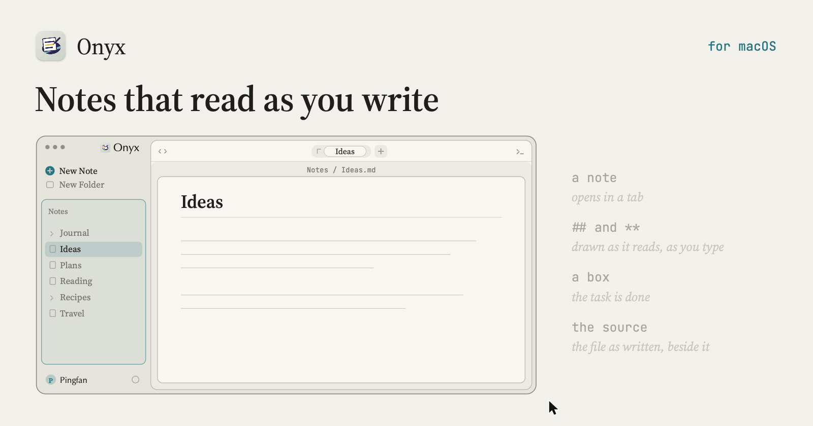

<p align="center"></p>

# Onyx

A note-taking app that keeps your notes as plain markdown files in a folder of your own and draws them as they read while you write. Rust and GPUI, for macOS, Windows and Linux, by Alkaline Software.

```
cargo build -p onyx-app && scripts/dev-app.sh
```

Download a release from the [releases page](https://github.com/alkaline-software/onyx/releases/latest). MIT licensed.
