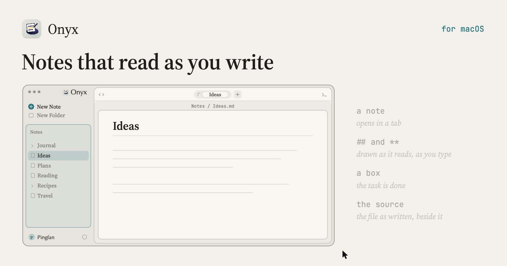

<p align="center"></p>

# Onyx

A note-taking app that keeps your notes as plain markdown files in a folder of your own and draws them as they read while you write. Rust and GPUI, for macOS, by Alkaline Software.

## Highlights

- **Your files, as they are.** A vault is a folder of markdown files. Onyx keeps no database and no copy of its own, so a vault made elsewhere opens as it is, and Onyx follows when another app or a sync service changes it.
- **Live preview.** Headings, bold, links, tasks, tables, code and pictures are drawn as they read; the marks show only on the line you are writing. The source can open beside the note, and the two follow each other.
- **Tabs by folder.** Notes open in tabs grouped on their folder's pill, and a note's name is edited right above its words.
- **More than text.** A note can hold pictures, a PDF's pages, another note or a document in a frame, and a web link can stand as a card. Wikilinks find their note anywhere in the vault.
- **The menu bar note.** Any note, one click away from Onyx's item in the menu bar or ⌃⌥⌘O from any app, with the same tree, tabs and editor as the main window.
- **A terminal beside the page**, opened in the vault's folder.
- **Export** a note as a PDF, an image, a Word document or a web page, or print it.
- **Spelling and grammar**, checked as you write.
- **Folder icons and colors**, kept with the vault so they travel with it.
- Light and dark, in eight languages.

## Get it

Download a release from the [releases page](https://github.com/alkaline-software/onyx/releases/latest). To build it yourself:

```
cargo build -p onyx-app && scripts/dev-app.sh
```

MIT licensed.
